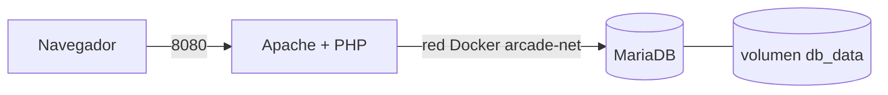

# 🕹️ Salón recreativo — Práctica final RA1

IAW 0376 · ASIR 2º · (Blai Camús)

## 1. Descripción del stack

| Componente | Tecnología | Dónde corre |
|---|---|---|
| Servidor web | Apache 2 (imagen php:8.3-apache) | Servidor (contenedor web) |
| Intérprete | PHP 8.3 + mysqli | Servidor |
| SGBD | MariaDB 11.4 | Servidor (contenedor db) |
| Cliente | Navegador + JavaScript | Cliente |

## 2. Arquitectura



## 3. Despliegue

### Local
```bash
git clone (URL_DE_MI_REPO) && cd salon-recreativo
cp .env.example .env    # y editar las dos contraseñas (distintas)
docker compose up -d --build
docker compose ps       # db debe estar "healthy"
```
Abrir http://localhost:8080

### Play with Docker
```bash
git clone (URL_DE_MI_REPO) && cd salon-recreativo
cp .env.example .env && vi .env
docker compose up -d --build
```
Abrir el puerto 8080 con el botón "OPEN PORT".

## 4. Nivel 1 — Base de datos

**¿Por qué no pasamos la contraseña de root al servicio web?**
(...)

**Resultado de `SHOW GRANTS;`**
```
+--------------------------------------------------------------------------------------------------------+
| Grants for jugador@%                                                                                   |
+--------------------------------------------------------------------------------------------------------+
| GRANT USAGE ON *.* TO `jugador`@`%` IDENTIFIED BY PASSWORD '<hash>'                                    |
| GRANT ALL PRIVILEGES ON `arcade`.* TO `jugador`@`%`                                                    |
+--------------------------------------------------------------------------------------------------------+
```
- ¿Sobre qué base de datos tiene permisos jugador? Sobre `arcade` (aparece como `arcade`.*). No tiene permisos sobre ninguna otra base de datos.
- ¿Por qué no usamos root desde la aplicación? Porque root tiene control total del servidor de base de datos. Si la web se compromete, con jugador solo se podría tocar arcade, pero con root se podría tocar todo.

**Persistencia (`down` vs `down -v`)**
(...)

🪙 **Moneda 1:** `ARC-7X3K`

## 5. Nivel 2 — PHP

**¿Qué se ejecuta en el servidor y qué en el cliente?**
En el servidor se ejecuta PHP, dentro del contenedor web (Apache + PHP). PHP se conecta a MariaDB con mysqli, consulta la tabla ranking, genera el HTML de la página y calcula la hora del servidor. Todo esto ocurre antes de que la página llegue al navegador, que solo recibe el resultado ya generado, sin ver el código PHP.
En el cliente, es decir, en mi navegador, se ejecuta JavaScript, que calcula y muestra la hora del navegador usando el reloj y la zona horaria de mi equipo.

**¿Por qué las dos horas pueden no coincidir?**
Porque proceden de relojes distintos y se calculan en momentos distintos:
- La hora de PHP es la del servidor (el contenedor), que normalmente usa la zona horaria UTC, mientras que la de JavaScript usa la zona horaria de mi ordenador.
- La hora de PHP se calcula una sola vez, cuando el servidor genera la página, y queda fija. La de JavaScript se calcula en el navegador.
- Los relojes del servidor y del cliente pueden estar desajustados entre sí.

🪙 **Moneda 2:** `ARC-Q9M2`

## 6. Nivel 3 — Seguridad

### Sin credenciales en el repositorio
```
(salida de git ls-files y de git log -p | grep -F "contraseña")
```

### Puerto 3306 no publicado
```
(salida de docker compose ps)
```

### La aplicación usa jugador, no root
(...)

### Apache y PHP no revelan versión
```
# 🕹️ Salón recreativo — Práctica final RA1

IAW 0376 · ASIR 2º · (tu nombre)

## 1. Descripción del stack

| Componente | Tecnología | Dónde corre |
|---|---|---|
| Servidor web | Apache 2 (imagen php:8.3-apache) | Servidor (contenedor web) |
| Intérprete | PHP 8.3 + mysqli | Servidor |
| SGBD | MariaDB 11.4 | Servidor (contenedor db) |
| Cliente | Navegador + JavaScript | Cliente |

## 2. Arquitectura


## 3. Despliegue

### Local
```bash
git clone (URL_DE_MI_REPO) && cd salon-recreativo
cp .env.example .env    # y editar las dos contraseñas (distintas)
docker compose up -d --build
docker compose ps       # db debe estar "healthy"
```
Abrir http://localhost:8080

### Play with Docker
```bash
git clone (URL_DE_MI_REPO) && cd salon-recreativo
cp .env.example .env && vi .env
docker compose up -d --build
```
Abrir el puerto 8080 con el botón "OPEN PORT".

## 4. Nivel 1 — Base de datos

**¿Por qué no pasamos la contraseña de root al servicio web?**
(...)

**Resultado de `SHOW GRANTS;`**
```
(pegar salida)
```
- ¿Sobre qué base de datos tiene permisos jugador? (...)
- ¿Por qué no usamos root desde la aplicación? (...)

**Persistencia (`down` vs `down -v`)**
**Prueba A: `docker compose down` y `docker compose up -d`**
Al ejecutar `docker compose down` se eliminaron los contenedores (web y db) y la red, pero no el volumen `db_data`. Al volver a levantar con `docker compose up -d` y consultar `SELECT * FROM ranking;`, los datos seguían ahí, incluida la fila de la moneda. Esto ocurre porque los datos de MariaDB se guardan en un volumen con nombre, que vive fuera del contenedor y sobrevive a su eliminación.

**Prueba B: `docker compose down -v` y `docker compose up -d`**
Con la opción `-v` se elimina también el volumen `db_data`. Al volver a levantar, MariaDB arrancó con el directorio de datos vacío, por lo que volvió a ejecutar `init.sql` y recreó la base de datos desde cero, con los datos iniciales. Cualquier dato que hubiera añadido después se habría perdido.

**Diferencia y por qué:**
`down` conserva los datos porque mantiene el volumen; `down -v` los borra porque elimina el volumen. `init.sql` solo se ejecuta cuando el volumen está vacío, es decir, la primera vez o después de un `down -v`.

🪙 **Moneda 1:** `ARC-7X3K`

## 5. Nivel 2 — PHP

**¿Qué se ejecuta en el servidor y qué en el cliente?**
(...)

**¿Por qué las dos horas pueden no coincidir?**
(...)

🪙 **Moneda 2:** `ARC-Q9M2`

## 6. Nivel 3 — Seguridad

### Sin credenciales en el repositorio
```

### Puerto 3306 no publicado
```
```bash
docker compose ps
```
```
NAME                     IMAGE                  COMMAND                  SERVICE   CREATED         STATUS                   PORTS
salon-recreativo-db-1    mariadb:11.4           "docker-entrypoint.s…"   db        8 minutes ago   Up 8 minutes (healthy)   3306/tcp
salon-recreativo-web-1   salon-recreativo-web   "docker-php-entrypoi…"   web       8 minutes ago   Up 8 minutes             0.0.0.0:8080->80/tcp, [::]:8080->80/tcp
```
El servicio db solo muestra `3306/tcp` (puerto interno de la red Docker), sin la forma `0.0.0.0:3306->3306`, por lo que no está publicado en el host. Solo web publica el 8080.

### Apache y PHP no revelan versión
```bash
curl -I http://localhost:8080
```
```
HTTP/1.1 200 OK
Date: Wed, 30 Sep 2026 17:48:31 GMT
Server: Apache
Content-Type: text/html; charset=UTF-8
```
La cabecera `Server` muestra solo `Apache`, sin número de versión (gracias a `ServerTokens Prod` y `ServerSignature Off`), y no aparece `X-Powered-By` (gracias a `expose_php = Off`). Ambas directivas se configuran en el Dockerfile.

En el docker-compose.yml el servicio web recibe `DB_USER: ${MARIADB_USER}` (que vale `jugador`) y `DB_PASS: ${MARIADB_PASSWORD}`. Nunca se le pasa la contraseña de root ni se usa `env_file: .env` en web.
```


### La aplicación usa jugador, no root
(...)

### Apache y PHP no revelan versión

```
(salida de curl -I http://localhost:8080)

```

🪙 **Moneda 3:** `(la da Ana en directo)`


## 7. Problemas que me encontré y cómo los resolví


1. **Problema:** (...)
   **Solución:** (...)

## 8. Monedas


| Nivel | Moneda |
|---|---|
| 1 | ARC-7X3K |

| 2 | ARC-Q9M2 |
| 3 | (...) |
